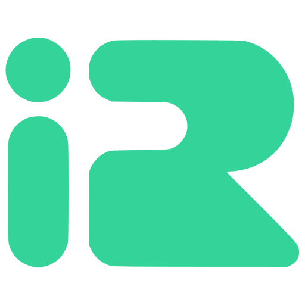

<p align="center">
  
</p>

<h1 align="center">IranRouter Cookbook</h1>

<p align="center">
  دستورهای کوتاه برای اتصال به <a href="https://iranrouter.net">IranRouter</a>
</p>

<p align="center">
  
</p>

IranRouter یک API سازگار با OpenAI است.
فقط `base_url` و کلید API را عوض کنید — بقیه مثل OpenAI / OpenRouter است.

## اتصال در یک نگاه

| مورد | مقدار |
|------|--------|
| Base URL | `https://iranrouter.net/api/v1` |
| Auth | `Authorization: Bearer ir-…` |
| Env key | `IRANROUTER_API_KEY` |
| Docs | https://iranrouter.net/docs |
| مدل‌ها | https://iranrouter.net/models |
| کلیدها | https://iranrouter.net/dashboard/keys |

## شروع در ۳ قدم

### ۱) کلید بگیرید

از [ثبت‌نام](https://iranrouter.net/register) حساب بسازید.
بعد در [داشبورد ← کلیدها](https://iranrouter.net/dashboard/keys) یک کلید `ir-…` بگیرید.

### ۲) کلید را ست کنید

```bash
export IRANROUTER_API_KEY="ir-..."
```

### ۳) اولین درخواست

```bash
curl https://iranrouter.net/api/v1/chat/completions \
  -H "Authorization: Bearer $IRANROUTER_API_KEY" \
  -H "Content-Type: application/json" \
  -d '{
    "model": "deepseek/deepseek-flash",
    "messages": [{"role": "user", "content": "سلام"}]
  }'
```

با پایتون:

```python
from openai import OpenAI

client = OpenAI(
    api_key="ir-...",
    base_url="https://iranrouter.net/api/v1",
)

print(client.chat.completions.create(
    model="deepseek/deepseek-flash",
    messages=[{"role": "user", "content": "سلام"}],
).choices[0].message.content)
```

با Node.js:

```js
import OpenAI from "openai";

const client = new OpenAI({
  apiKey: "ir-...",
  baseURL: "https://iranrouter.net/api/v1",
});

const r = await client.chat.completions.create({
  model: "deepseek/deepseek-flash",
  messages: [{ role: "user", content: "سلام" }],
});
console.log(r.choices[0].message.content);
```

## فهرست دستورها (Recipes)

### پایه

| دستور | موضوع |
|-------|--------|
| [شروع سریع](recipes/getting-started.md) | کلید، Base URL، احراز هویت |
| [curl](recipes/curl.md) | درخواست HTTP خام |
| [پایتون](recipes/python.md) | OpenAI SDK / helper |
| [Node.js](recipes/node.md) | OpenAI SDK / helper |
| [استریم](recipes/streaming.md) | SSE مثل OpenAI |
| [Embeddings](recipes/embeddings.md) | بردار متن |
| [تصویر](recipes/images.md) | تولید تصویر |
| [بررسی کلید](recipes/check-key.md) | وضعیت کلید و اعتبار |
| [رفع خطا](recipes/troubleshooting.md) | 401 / 402 / 404 / 429 |

### ابزارها و ایجنت‌ها

| دستور | موضوع |
|-------|--------|
| [OpenCode](tools/opencode.md) | ایجنت ترمینال / IDE |
| [Kilo Code](tools/kilo.md) | افزونه VS Code / JetBrains |
| [DeepSeek Harness](tools/deepseek-harness.md) | Custom model API |
| [OpenDesign](tools/open-design.md) | طراحی موشن با API |

نسخهٔ زندهٔ همین راهنماها روی سایت:

- https://iranrouter.net/guides
- https://iranrouter.net/guides/opencode
- https://iranrouter.net/guides/kilo
- https://iranrouter.net/guides/deepseek-harness
- https://iranrouter.net/guides/open-design

## مدل‌های رایج

شناسه را از [کاتالوگ](https://iranrouter.net/models) کپی کنید:

- `deepseek/deepseek-flash` — شروع / سطح رایگان
- `openai/gpt-4o-mini` — چت سبک / سطح رایگان
- `openai/gpt-4o` — چت قوی‌تر
- `openai/gpt-image-2.5-sunburst` — تصویر

جزئیات سطح رایگان: [مستندات](https://iranrouter.net/docs#free-tier)

## endpointهای اصلی

| متد | مسیر |
|-----|------|
| `GET` | `/models` |
| `GET` | `/key` |
| `POST` | `/chat/completions` |
| `POST` | `/embeddings` |
| `POST` | `/images/generations` |
| `POST` | `/images/edits` |
| `POST` | `/videos/generations` |
| `GET` | `/generation/{id}` |

## ریپوهای مرتبط

| ریپو | کاربرد |
|------|--------|
| [iranrouterPython](https://github.com/BytelabsTeam/iranrouterPython) | helper و مثال پایتون |
| [iranrouter-node](https://github.com/BytelabsTeam/iranrouter-node) | helper و مثال Node.js |
| [iranrouter-examples](https://github.com/BytelabsTeam/iranrouter-examples) | نمونهٔ curl / python / node |

## نکات

- کلید را در کد commit نکنید؛ از env استفاده کنید.
- به انتهای Base URL مسیر `/chat/completions` اضافه نکنید.
- پاسخ chat موفق معمولاً هدر `X-Request-Id` دارد.
- خطای سهمیه رایگان تمام‌شده معمولاً HTTP `402` است.
- محدودیت نرخ: حدود ۶۰ درخواست / ۶۰ثانیه به ازای هر کلید.

## لینک‌ها

- سایت: https://iranrouter.net
- مستندات API: https://iranrouter.net/docs
- راهنماهای اتصال: https://iranrouter.net/guides
- کلیدها: https://iranrouter.net/dashboard/keys
- شارژ اعتبار: https://iranrouter.net/dashboard/credits

## کمک و مشارکت

اگر راهنمایی، مثال بیشتر، یا بهبودی لازم داشتید:

- در [Issues](https://github.com/BytelabsTeam/iranrouter-cookbook/issues) بنویسید
- یا درخواست‌تان را در [Wiki](https://github.com/BytelabsTeam/iranrouter-cookbook/wiki) بگذارید

MIT — [Bytelabs](https://github.com/BytelabsTeam)
